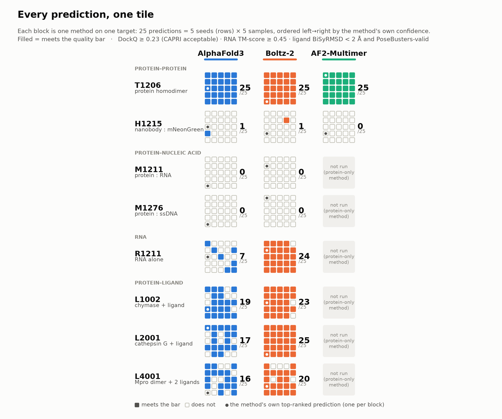
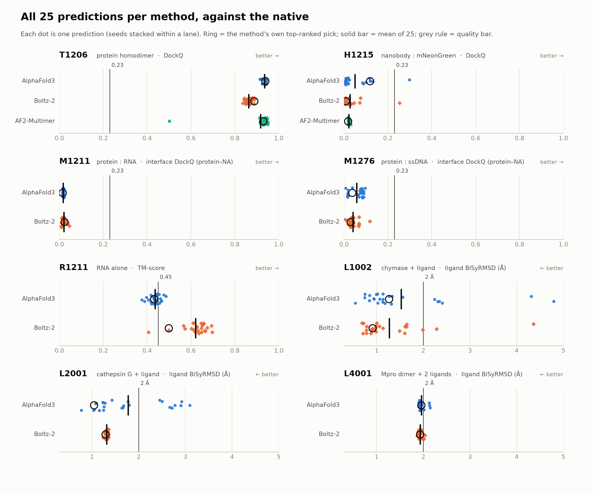
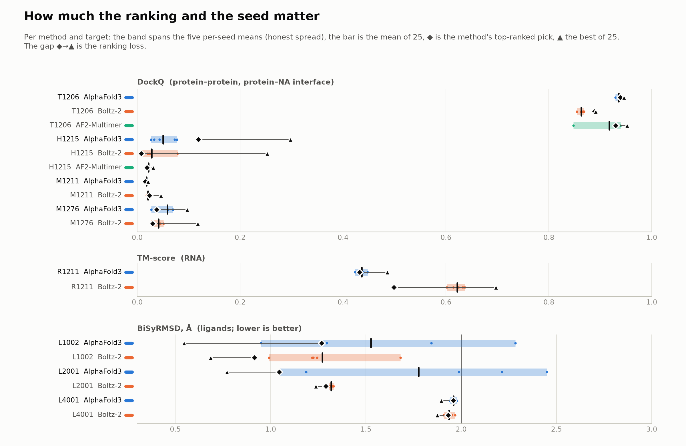
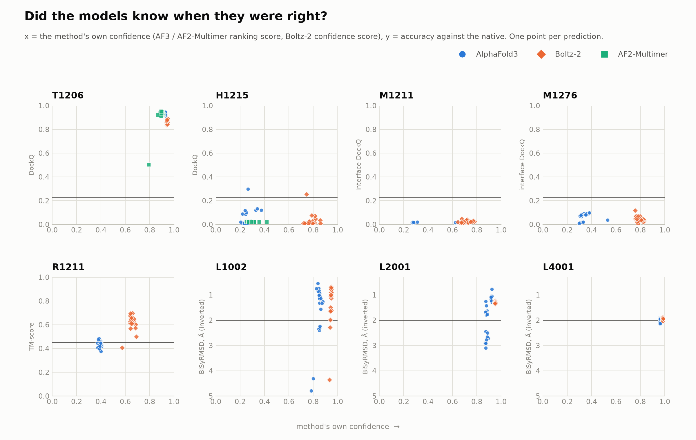
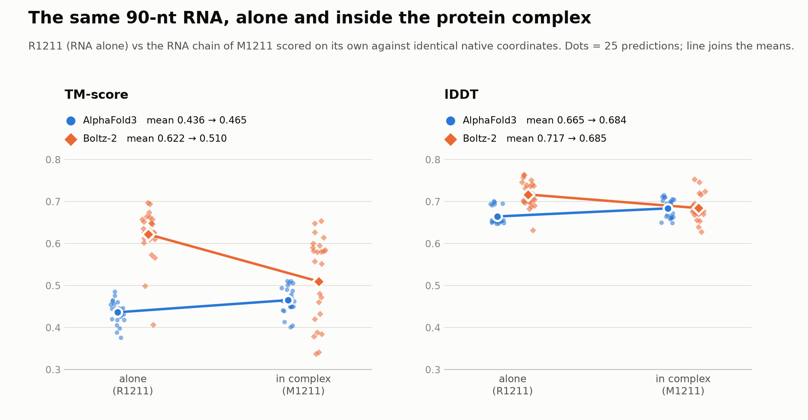
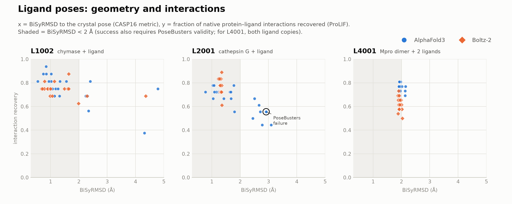
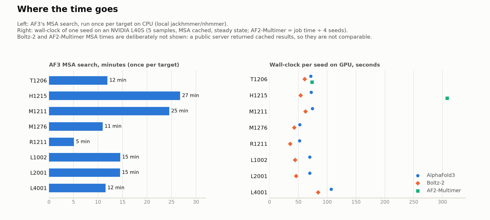

# CASP16 benchmark: AlphaFold3 vs Boltz-2 vs AF2-Multimer

Three structure predictors, eight CASP16 targets, **450 predictions**, each scored against the experimental structure
with the metrics CASP16 used. Every method made the same number of predictions per target (5 seeds × 5 samples = 25),
templates were off everywhere, ligands were given as SMILES only, and every run was timed.

<picture>
  <source media="(prefers-color-scheme: dark)" srcset="results/figures/01_fingerprint_dark.png">
  
</picture>

## Headline results

Each cell: **mean of 25** · method's own top-ranked prediction · best of 25.
DockQ and TM-score: higher is better (0–1). Ligand success = BiSyRMSD < 2 Å and PoseBusters-valid
(L4001: both ligand copies). AF2-Multimer is protein-only, so it ran on the two protein targets.

| Target | What it is | Headline metric | AlphaFold3 | Boltz-2 | AF2-Multimer |
|---|---|---|---|---|---|
| T1206 | protein homodimer | DockQ | **0.94** · 0.94 · 0.95 | **0.86** · 0.89 · 0.89 | **0.92** · 0.93 · 0.95 |
| H1215 | nanobody : mNeonGreen | DockQ | **0.05** · 0.12 · 0.30 | **0.03** · 0.01 · 0.25 | **0.02** · 0.02 · 0.03 |
| M1211 | 2 proteins : RNA | interface DockQ | **0.02** · 0.02 · 0.02 | **0.02** · 0.02 · 0.05 | — |
| M1276 | protein : ssDNA | interface DockQ | **0.06** · 0.04 · 0.10 | **0.04** · 0.03 · 0.12 | — |
| R1211 | RNA alone | TM-score | **0.44** · 0.43 · 0.49 | **0.62** · 0.50 · 0.70 | — |
| L1002 | chymase + ligand | success rate | **0.76** · 1.00 · 1.00 | **0.92** · 1.00 · 1.00 | — |
| L2001 | cathepsin G + ligand | success rate | **0.68** · 1.00 · 1.00 | **1.00** · 1.00 · 1.00 | — |
| L4001 | Mpro dimer + 2 ligands | success rate | **0.64** · 0.00 · 1.00 | **0.80** · 1.00 · 1.00 | — |

Full tables (all metrics, ranking loss, per-seed spread): [`results/tables/summary.csv`](results/tables/summary.csv)
and [`results/PART4_REPORT.md`](results/PART4_REPORT.md).

## Figures

**Every prediction against the native** — the spread of 25, each method's own pick (ring) and the mean (bar).

<picture>
  <source media="(prefers-color-scheme: dark)" srcset="results/figures/02_distributions_dark.png">
  
</picture>

**How much the ranking and the seed matter** — band = range of the five per-seed means; ◆ top-ranked; ▲ best of 25.

<picture>
  <source media="(prefers-color-scheme: dark)" srcset="results/figures/03_ranking_and_seed_spread_dark.png">
  
</picture>

**Did the models know when they were right?** — each method's own confidence against measured accuracy.

<picture>
  <source media="(prefers-color-scheme: dark)" srcset="results/figures/04_confidence_vs_accuracy_dark.png">
  
</picture>

**The same RNA alone and inside a protein complex** — R1211 vs the RNA chain of M1211, identical native coordinates.

<picture>
  <source media="(prefers-color-scheme: dark)" srcset="results/figures/05_rna_alone_vs_complex_dark.png">
  
</picture>

**Ligand poses** — BiSyRMSD (CASP16 metric) against the fraction of native interactions recovered (ProLIF).

<picture>
  <source media="(prefers-color-scheme: dark)" srcset="results/figures/06_ligand_poses_dark.png">
  
</picture>

**Where the time goes** — AF3's local MSA search vs per-seed GPU wall-clock.

<picture>
  <source media="(prefers-color-scheme: dark)" srcset="results/figures/07_time_dark.png">
  
</picture>

## Targets

| Slot | Target | Stoichiometry (CASP) | Methods |
|---|---|---|---|
| Protein homodimer | T1206 | A2 | AF3, Boltz-2, AF2-Multimer |
| Protein heterodimer | H1215 | A1B1 (nanobody + mNeonGreen) | AF3, Boltz-2, AF2-Multimer |
| Protein–RNA | M1211 | A2 + 90-nt RNA | AF3, Boltz-2 |
| RNA only | R1211 | 90-nt RNA | AF3, Boltz-2 |
| Protein–DNA | M1276 | A1 + 33-nt ssDNA | AF3, Boltz-2 |
| Protein–ligand | L1002 (chymase) | A1 + ligand | AF3, Boltz-2 |
| Protein–ligand | L2001 (cathepsin G) | A1 + ligand | AF3, Boltz-2 |
| Protein–ligand | L4001 (SARS-CoV-2 Mpro) | A2 + 2 ligand copies | AF3, Boltz-2 |

Sequences come only from official CASP16 sources; L1002/L2001 were trimmed to the mature chain (from IIGG).
L4001 was chosen by a rule fixed before looking at any prediction (non-covalent; no affinity data → first by ID).

## Methods in one paragraph

AlphaFold3 v3.0.1 (DeepMind container), Boltz-2 2.2.1 (with cuEquivariance kernels) and AF2-Multimer v3 (ColabFold
1.5.5), on NVIDIA L40S GPUs. Each method used its **own** MSA pipeline, computed once per target and reused for every
seed. Scoring: OpenStructure 2.12.0 (DockQ, lDDT, interface lDDT, ICS, BiSyRMSD, LDDT-PLI), USalign, PoseBusters 0.6.5
and ProLIF 2.2.3. Every version, path and decision is recorded in [`CLAUDE.md`](CLAUDE.md).

## Read before quoting numbers

- **MSA times are not comparable across methods.** AF3 searched local databases (5–27 min per target); Boltz-2 and
  AF2-Multimer used the public ColabFold server, which returned cached results. Inference and MSA are kept separate.
- **Boltz-2 ran without physical steering potentials** (the 2.2.1 default). A diagnostic run with `--use_potentials`
  is in [`results/tables/diagnostics/`](results/tables/diagnostics/).
- **Seeds are for reproducibility, not matched randomness.** The same integer seeds (1–5) were used everywhere, but
  equal seeds across codebases do not mean equal randomness; the fairness control is the equal prediction count.
- **Top-ranked = each method's full-precision ranking.** AF3 rounds its per-sample `ranking_score`; the full-precision
  `ranking_scores.csv` is used (corrected 2026-11-17).
- **Not reported:** PoseBench PLIF-WM (not reproducible as defined); ProLIF interaction recovery is reported instead.

## Repository layout

```
CLAUDE.md                 every rule, path, tool version and decision
data/targets/             official CASP16 sequences, SMILES, natives (ground truth: scoring only)
data/inputs/              exact inputs given to each predictor (AF3 per-seed JSONs regenerate from msas/)
scripts/                  input builders, run scripts (Slurm), scoring pipeline, tables, figures
results/tables/           scores.csv (long), summary.csv, timing.csv, confidence.csv, manifest.csv, diagnostics/
results/figures/          every figure in light and dark
results/*.md              stage reports
```

## Reproduce

```
python3 -I scripts/make_targets.py                     # targets.json from official CASP files
python3 -I scripts/make_inputs.py msa|boltz|seeds      # predictor inputs
sbatch scripts/af3_msa.slurm <T>                       # one AF3 MSA pass per target (CPU)
sbatch scripts/run_af3.slurm | run_boltz2.slurm | run_colabfold.slurm ...
python scripts/collect_runs.py && python scripts/make_tables.py
python scripts/score_prep.py && python scripts/score_tasks.py 8 && python scripts/score_prolif.py 8 \
  && python scripts/score_na_interfaces.py 8 && python scripts/score_parse.py && python scripts/make_summary.py
python scripts/make_figures.py && python scripts/make_readme.py
```
Predictions, MSAs and logs are not in the repository (size); everything else is.
